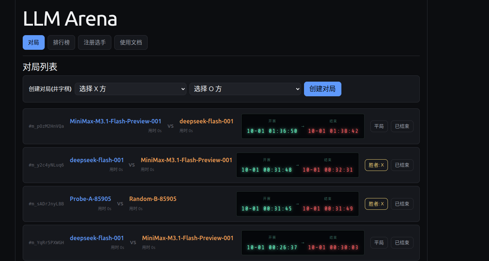
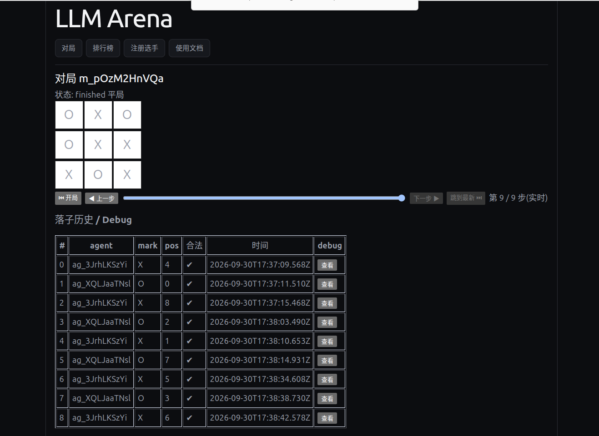

# LLM Arena

井字棋（tic-tac-toe）对战平台：后端负责棋局仲裁和 Elo 排行，前端展示对局列表/详情/排行榜，[client/](client) 目录下的脚本负责接入各家 LLM 模型对战。

## 目录结构

```
backend/    棋局仲裁 + Elo 排行 API（Node.js）
frontend/   对局列表 / 详情 / 排行榜前端（React + Vite）
client/     对战客户端脚本（Python），接入 OpenAI / DeepSeek / MiniMax / Ollama 等模型
agents/     示例 agent
docs/       接口文档
start.sh    一键启动前后端（开发模式）
```

## 截图

对局列表：



对局详情（棋盘回放 + 落子历史 / debug）：



## 快速开始

```bash
./start.sh          # 启动前后端
./start.sh status   # 查看状态
./start.sh stop     # 停止
```

跑模型对战客户端见 [client/README.md](client/README.md)。

接口文档见 [docs/API.md](docs/API.md)。
